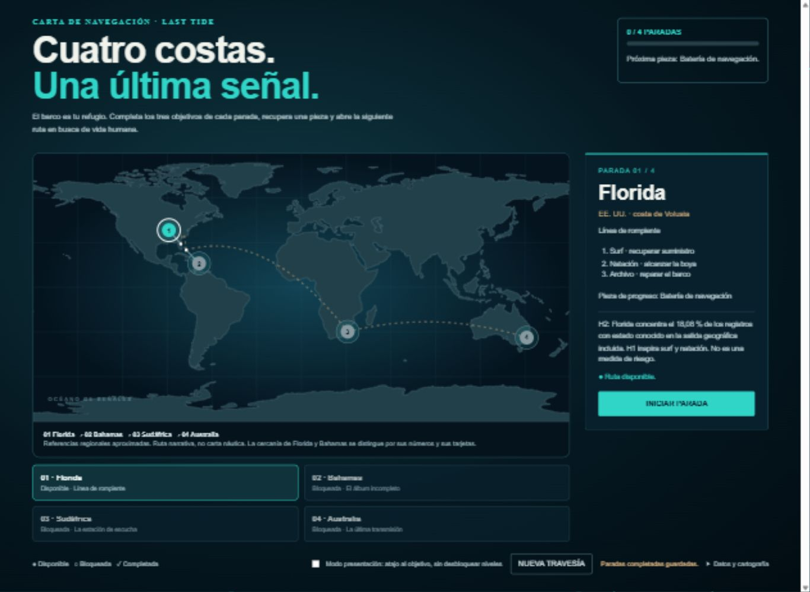

# LAST TIDE: El último humano

Proyecto final de **Data Analytics de Ironhack**. Analizamos registros históricos del Global Shark Attack File (GSAF) y utilizamos sus patrones y limitaciones para diseñar un concepto de videojuego de supervivencia y exploración.

**Equipo:** Adriana Rojas Rodríguez, Edvaldo, Jordi Callejo, Alejandro y Jose Galindo. Repositorio de entrega de Jordi Callejo.

## Acceso rápido

- [Presentación final: 9 diapositivas (PDF)](01_Presentacion/LAST_TIDE_Presentacion_Final_9_Diapositivas.pdf)
- [Presentación editable (PPTX)](01_Presentacion/LAST_TIDE_Presentacion_Final_9_Diapositivas.pptx)
- [Guion oral por diapositiva: ponente, texto y tiempos](02_Guiones/LAST_TIDE_Guion_Exposicion_3_Minutos.pdf)
- [Videojuego: HTML autónomo](03_Videojuego/LAST_TIDE_Juego.html)
- [Instrucciones del mapa y de la demostración](03_Videojuego/GUIA_MAPA_MUNDIAL.md)
- [Código y documentación del análisis](04_Analisis_Datos/data-cleaning-pandas/README.md)
- [Cuaderno del análisis](04_Analisis_Datos/data-cleaning-pandas/notebooks/shark_attacks.ipynb)
- [Informe de pruebas del mapa mundial](05_Verificacion/VERIFICACION_MAPA_MUNDIAL.md)



## Preguntas de investigación

| Hipótesis | Pregunta |
| --- | --- |
| H1: actividad | ¿Qué actividades aparecen con más frecuencia y en qué contextos? |
| H2: ubicación | ¿Dónde se concentran los registros documentados? |
| H3: desenlace | ¿Cómo cambia la distribución de actividades y especies entre registros mortales y no mortales? |
| H4: especies | ¿Qué especies se atribuyen a las distintas actividades y zonas? |

El análisis es descriptivo. Los incidentes registrados **no miden exposición ni riesgo individual**, y las asociaciones no prueban causalidad. Las bases y las reglas de clasificación no son idénticas en todos los análisis del equipo; sus límites están documentados en `05_Verificacion`.

## Abrir el juego

1. En GitHub, pulsar **Code > Download ZIP** y extraer la carpeta.
2. Abrir `00_ABRIR_JUEGO.html` y seguir el enlace al juego.
3. Si el navegador restringe archivos locales, desde la raíz del proyecto ejecutar:

```bash
python -m http.server 8000
```

Abrir `http://localhost:8000/03_Videojuego/LAST_TIDE_Juego.html`.

GitHub muestra el código HTML; no lo ejecuta directamente desde la vista del repositorio. No hace falta instalar dependencias para jugar. El mapa, los estilos y el código están incluidos en el HTML.

### Progresión

**Florida → Bahamas → Sudáfrica → Australia.** Cada parada tiene tres objetivos y una pieza. Al completar los objetivos y confirmar la recuperación de la pieza se desbloquea la siguiente parada. Las referencias geográficas y su orden son una propuesta narrativa, no una clasificación de peligrosidad.

- WASD o flechas: navegar.
- E: investigar un objetivo cercano o instalar la pieza tras completar los tres.
- Espacio: sonar visual.
- M: mapa y pausa.
- Modo presentación: botón para acercarse al objetivo, sin completar ni desbloquear automáticamente.

El prototipo es cenital y conceptual. Surf, natación, pesca, pesca submarina y buceo inspiran sus objetivos; no se presentan como cinco simuladores implementados. El oxígeno, el hambre y otros sistemas del concepto narrativo no forman parte de la demo actual.

## Reproducir el análisis

Desde `04_Analisis_Datos/data-cleaning-pandas`:

```bash
python -m pip install -r requirements.txt
python -m unittest test_pipeline.py
python run_analysis.py data/GSAF5.xlsx
```

Los resultados se escriben en `outputs/`. El README de esa carpeta de análisis documenta las reglas y las diferencias con las cifras de las diapositivas.

Para verificar la lógica de progresión del juego, con Node.js instalado, desde la raíz:

```bash
node 05_Verificacion/comprobar_mapa.cjs
```

## Material de entrega y verificación

La presentación y el guion de exposición están preparados para nueve diapositivas y unos tres minutos orientativos. Los tiempos requieren ensayo. El guion PDF de demostración original puede describir la versión anterior: para el juego actual prevalece `GUIA_MAPA_MUNDIAL.md`.

La campaña se ha probado en navegador mediante HTTP local, completando las cuatro paradas con el modo presentación. Se comprobaron bloqueo secuencial, pausa, recuperación del progreso al recargar, nueva partida y controles móviles. Los límites de estas pruebas están en el informe. No se afirma una simulación biológica del comportamiento de los tiburones.

**Fuentes:** GSAF, datos del archivo incluido y análisis del equipo. Cartografía del prototipo: Natural Earth, tierra a escala 1:110m, dominio público; atribución detallada en la guía del juego. Las rutas, recompensas y reglas de daño son decisiones de ficción.

La carpeta de referencias internas del paquete de trabajo se ha excluido de esta entrega.
